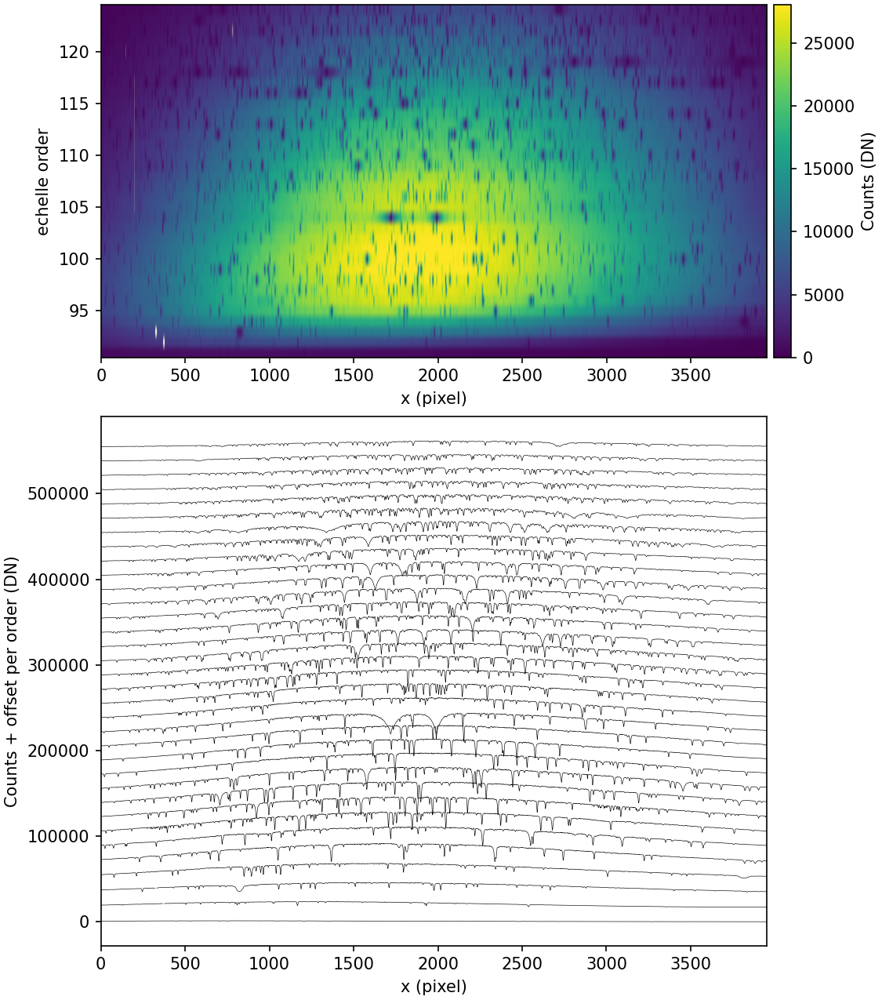

**Client:** University of Chicago, for Gemini Observatory. **Role:** scientific software developer, remote contractor. **Code:** [GeminiDRSoftware/MAROONXDR](https://github.com/GeminiDRSoftware/MAROONXDR)

## The problem

MAROON-X is a high-precision radial velocity spectrograph at Gemini North, used to find Earth-sized exoplanets. Its data reduction lived in a legacy HDF5-based pipeline that only the instrument team could run. Gemini needed it inside their standard DRAGONS framework so observers could reduce their own data.

## What I did

- Ported the pipeline to a FITS and AstroData architecture inside DRAGONS, working with the instrument team in Chicago.
- Re-implemented the 2D image processing: darks, flats and stray light removal.
- Echelle order tracing, optimal spectral extraction, drift-corrected wavelength calibration and barycentric correction.
- A calibration database with SQL integration.
- A full pytest suite, GitHub Actions CI and a user manual on Read the Docs.

## Outcome

The pipeline was delivered to Gemini Observatory and is now in production use by the instrument team for MAROON-X data reduction.
