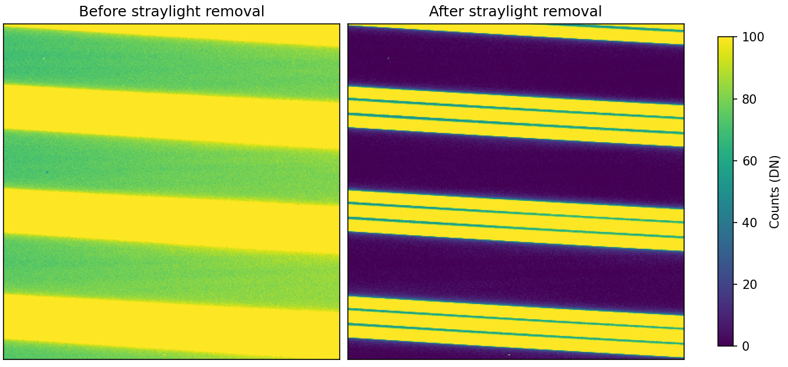

**Client:** University of Chicago, for Gemini Observatory.\
**Role:** scientific software developer, remote contractor, November 2024 to September 2026.\
**Code:** [GeminiDRSoftware/MAROONXDR](https://github.com/GeminiDRSoftware/MAROONXDR) · [Documentation](https://maroonxdr.readthedocs.io/latest/)

## The problem

MAROON-X is a high-precision radial velocity spectrograph on the Gemini North telescope, built by the University of Chicago to find Earth-sized planets around nearby M dwarfs. Every science frame is a pair of 4400 by 4400 pixel images, one per spectrograph arm, with five fibres traced across 34 and 28 echelle orders. Its reduction lived in the instrument team's own HDF5-based pipeline.

DRAGONS is the Python framework Gemini uses to reduce data from its instruments. MAROON-X needed a pipeline built on it, so that its data could be reduced with the same tools and conventions as the rest of the observatory's.

## What I did

I took over an early prototype in 2025 and carried it to its first tagged releases, working with the instrument team in Chicago and the DRAGONS team at Gemini.

- Ported the legacy reduction, step by step, to a FITS and AstroData architecture: archive bundle splitting, master and synthetic darks, flats, stray light removal, order tracing, box and optimal extraction, and blaze measurement.
- Wavelength calibration from the etalon frames, with drift correction, fiber combination and barycentric correction from the exposuremeter recordings.
- Integration with the DRAGONS calibration database, including the new calibration types MAROON-X needs.
- Regression tests that compare each product against the legacy pipeline's output, unit tests on GitHub Actions, and tools that build the instrument lookup files (bad pixel masks, order traces, wavelength solutions) from the legacy HDF5 files.
- Tutorial, user manual and programmer manual, with recipe and primitive reference pages generated from the docstrings, plus interactive QA recipes with a Bokeh spectrum viewer.

## Outcome

Three tagged releases between August and October 2026, the latest on DRAGONS 4.2.2. The pipeline reduces science frames end to end, from the raw archive bundle to wavelength-calibrated, barycentric-corrected 1D spectra, and the instrument team uses it for MAROON-X reduction. It is still marked pre-release on GitHub: it is distributed from the repository rather than PyPI or conda.

*Header photo: MAROON-X mounted at Gemini North. Credit: International Gemini Observatory/NOIRLab/NSF/AURA/J. Bean, [CC BY 4.0](https://creativecommons.org/licenses/by/4.0/).*
